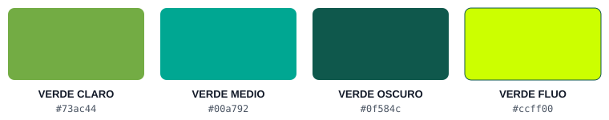

# SCREENCALC

Calculadora web de pantallas LED. A partir de lo que pide el cliente (medidas, uso, distancia de visión, resolución, electrónica) propone el modelo de cabinet, calcula la pantalla y genera un listado completo de proyecto llave en mano, con simulación, electrónica de control, mediaserver, esquema de conexiones y PDF.

**Versión actual: v4.6**

Web principal: **https://screencalc.mediaservi.com**

Copias redundantes: https://mediaservi.github.io/SCREENCALC/ · https://screencalcx.netlify.app/

## Para qué sirve

Para pasar de una petición como *"pantalla led para exterior de 6x2 metros que se lea bien a 4 m"* a una propuesta técnica verificable: modelo de cabinet, número de cabinets, resolución, peso, consumo, líneas de señal, electrónica y mediaserver recomendados, todo exportable a PDF en una hoja A4.

## Funciones

- **Petición en lenguaje natural (📝):** se pega el texto del cliente y la app propone una pantalla. Si falta un dato, pregunta con un popup; lo que ya viene en el texto no se vuelve a preguntar. Se interpreta con reglas locales, sin servicios externos de IA.
- **Preguntas de proyecto llave en mano:** uso (interior, exterior, escaparate), instalación o alquiler, distancia del público, ¿cerca del mar o mucha humedad? (variante tropicalizada con contactos de oro), electrónica sí/no (con o sin backup, con o sin escalador, conexión RJ45 o rack con fibra), mediaserver (marca, Dante), número, tipo y resolución de las fuentes de vídeo y distancia de las fuentes.
- **Panel de entrada manual:** INSTALL / RENTAL, INDOOR / OUTDOOR / ESCAPARATE, pitch y nits (valores de la tabla con flechas ▲▼), COLUMNAS y FILAS, ancho y alto con selector de unidad m / cm / mm (por defecto cm; el PDF sigue la unidad elegida), resolución mínima (HD / FHD / UHD 4K) y altura sobre el suelo. Muestra en vivo medidas, cabinets y resolución.
- **Modo resumen:** si la petición se hizo en texto, el panel solo muestra lo elegido. Con "Editar a mano" se vuelve al panel completo. En móvil, el botón flotante ⚙ PANEL vuelve al panel desde los resultados.
- **Resultados:** características de la pantalla en tarjetas (dimensiones, resolución con niveles HD / FHD / 4K / 8K, distancia de visión mínima y óptima, cabinets, instalación, señal y alimentación), en hasta 3 columnas en PC y apiladas en móvil.
- **Simulación a escala:** figura humana, cotas, cuadros de resolución y resumen, con layout dinámico que aprovecha el espacio sin desbordes en PC y móvil. El vídeo por defecto es https://youtu.be/vKN4AcGz7zs.
- **Electrónica de control:** motor propio basado en especificaciones del fabricante (NovaStar MCTRL, VX Pro, NovaPro, COEX MX y H Series, con tarjetas de salida y de entrada). Admite con o sin backup y conexión directa por RJ45 o rack con fibra y convertidores CVT10 Pro.
- **Mediaserver:** NovaStar (ET) y PixelHue, con filtro por marca, audio Dante y número de entradas, y un resumen de características en cada opción.
- **Elección manual de equipos:** clic en una burbuja de electrónica o de mediaserver para elegirla; otro clic la quita.
- **Esquema de conexiones y material (llave en mano):** diagrama con símbolos AV y colores por señal (vídeo, Ethernet, fibra, alimentación, control, backup) y listado de material, que incluye el cable HDMI PureLink FlexInstall más adecuado a la distancia de las fuentes. Se muestra en resultados y es la página 2 de ambos PDF.
- **Enlaces e imágenes de producto:** icono de enlace (a la ficha o a la búsqueda de Charmex por modelo) y, en electrónica, pila de logo, vista frontal y trasera con visor al 80 % de la pantalla. Se leen de la hoja ELECTRONICAS (columnas `url`, `front`, `back`, `logo`) cada vez que se abre la app; las imágenes no van al PDF.
- **Contenido de la pantalla (🖼):** el icono de imagen abre un popup centrado con FUENTES MULTIMEDIA DE PRUEBA (la primera es fija y va preseleccionada; las otras 5 son editables y se guardan en el navegador), URL propia (YouTube normal, /live/, /shorts/, listas, Vimeo, imagen o vídeo) y subida de archivo.
- **Esquemas de cableado:** propuesta de cableado de señal y eléctrico.
- **PDF:** un único PDF de 2 páginas desde el icono de la cabecera. Página 1: características de la pantalla, observaciones, características del cabinet y simulación. Página 2: electrónica y mediaserver elegidos para el proyecto (en una fila), esquema de conexiones con su material, propuestas de cableado de señal y eléctrico, y el aviso de cálculo por IA. Si no cabe, el esquema se reduce para mantener las 2 páginas. El logo de AVHUB (con enlace) va arriba a la derecha de la página 1, encima de la fecha. Los anuncios no salen en el PDF.
- **Información (ⓘ):** el icono de la cabecera ofrece 2 opciones: **INFORMACIÓN** (este README en una ventana al 80 % que se puede desplazar y cerrar) y **DESCARGAR APP** (uso sin conexión).
- **Logo:** sin enlace; al pulsarlo se reinicia la app para un nuevo cálculo (igual que RESET).
- **SCREENBOX:** el isotipo de la cabecera abre la sub-app SCREENBOX (https://screenboxsim.netlify.app/) para pantallas de una o varias paredes con proyectores y salas inmersivas.
- **Folleto del modelo:** desde la tarjeta del cabinet se abre en una pestaña nueva la ficha del modelo en la web del fabricante, buscada por su referencia.
- **Administrador:** acceso solo para el propietario con su cuenta de Google (la comprobación se hace en el servidor). Desde ahí se abren el gestor de anuncios, las consultas internas y la documentación (DOCS), que ya no es pública.
- **Anuncios (motor AVHUB ADS):** 3 zonas (pie del menú y pie de resultados, izquierda y derecha). Cada zona admite varios anuncios con rotación; cada anuncio tiene formato estándar (horizontal 16:9, vertical 9:16, cuadrado 1:1, retrato 4:5, hero a sangre 21:9, banner 728×90, banner móvil 320×100, rectángulo 300×250, rascacielos 160×600), texto al lado, debajo, encima o sin texto, botón opcional, carrusel de fotos, vídeos y YouTube, fechas de inicio y fin, solo móvil o solo escritorio, y contador de clics. Todo el anuncio abre su enlace en una pestaña nueva (o `ads.json` mientras el panel no responda).
- **AVHUB ADMIN (`admin/anuncios.html`):** panel interno con 4 pestañas (la cuarta, **CATÁLOGO**, gestiona los modelos que usa la app y prepara el informe de incoherencias de la web para marketing): **ANUNCIOS** (gestor de abajo), **FIRMAS** (firmas de correo visuales con 4 plantillas, iconos de redes en línea o en círculo, iconos de contacto, banners estáticos, animados en GIF con transiciones o en mosaico con un enlace por imagen y contador de clics; se copian listas para pegar en Gmail, Outlook o Apple Mail) y **NEWSLETTER** (editor por bloques arrastrables: cabecera, título, texto, imagen, botón, oferta, dos columnas, redes, firma y pie con baja; vista escritorio y móvil, ofertas creadas desde los anuncios, exportación HTML y envío de prueba o a una lista desde el panel).
- **Página de configuradores (`configuradores/`):** compara SCREENCALC y el configurador oficial de TRAULUX y lleva a cada uno (es / en / ca).
- **Gestor de anuncios (`admin/anuncios.html`, pestaña ANUNCIOS):** pantalla visual para arrastrar anuncios entre zonas, arrastrar fotos entre anuncios o desde la biblioteca, subir fotos, elegir formato y ver al lado de cada anuncio el previo real en escritorio o móvil. En el panel de administrador guarda de verdad; abierto desde el repositorio funciona en modo demo (guarda en el navegador) y `index.html?anuncios=demo` muestra esos anuncios de prueba. Como afiliado de Amazon, se obtienen ingresos por las compras adscritas que cumplen los requisitos aplicables.
- **Adaptada a PC y móvil:** el panel lateral de entrada va en 2 columnas sin scroll en PC y se ve en grande en móvil.

- **AVHUB:** el logo de AVHUB en la cabecera (entre el logo de SCREENCALC y los iconos) lleva a https://avhub.mediaservi.com/. AVHUB es la nueva app en preparación que reunirá en un solo sitio SCREENCALC, el hardware de proyectos AV, novedades y VJSHOW, con el mismo idioma en todas las secciones.

## Datos

La app obtiene el catálogo en vivo y lo guarda cifrado en el dispositivo; no se expone como tabla ni se puede exportar. No usa datos de muestra salvo como último recurso sin conexión. El catálogo de electrónica y mediaservers está en el propio `index.html` (constantes `ELEC_DEVICES` y `ELEC_MEDIASERVERS`).

## Tecnología y despliegue

Archivo único `index.html` con React 18, Babel Standalone 7.29.0 y Tailwind. No necesita compilación. Los recursos gráficos están en `assets/` y se referencian con rutas relativas, por lo que funciona igual en Netlify y en GitHub Pages.

## Ramas

- `main`: versión oficial y pública, aprobada.
- `beta`: última entrega para pruebas; `beta-anterior`: la entrega previa. Solo pasan a `main` cuando se aprueban.

## Paleta corporativa

La app usa solo estas cuatro tonalidades de verde (además de blanco, negro, grises y los colores que no son verde):

| Nombre | Código | Uso |
|---|---|---|
| VERDE CLARO | `#73ac44` | acentos secundarios y estado «óptimo» |
| VERDE MEDIO | `#00a792` | botones y elementos activos |
| VERDE OSCURO | `#0f584c` | cabeceras de sección y fondos principales |
| VERDE FLUO | `#ccff00` | resaltes y parpadeos de campos por rellenar |

## Avisos

- ⚠️ APP experimental con motor IA que puede cometer errores. Verifique los resultados con su método de cálculo habitual.
- *Estas propuestas se calculan automáticamente por IA que puede cometer fallos. Verifique estos cálculos mediante su método habitual o contrastando con un técnico. Algunas electrónicas menos recientes pueden tener limitaciones entre columnas que invalidarían esta propuesta de conectividad.

## Cambios de la versión actual (v4.6)

- **Catálogo maestro:** la app lee los modelos del catálogo que se gestiona en el panel (pestaña CATÁLOGO): se importa una vez, se completa y contrasta automáticamente con las fichas de la web de producto, y se edita a mano lo que falte. Solo se envían los datos técnicos, nunca precios.
- Si el panel no responde, la app usa el último catálogo guardado en el dispositivo o la consulta anterior como respaldo.

## Cambios de la v4.5

- **Nuevo motor de anuncios AVHUB ADS**, el mismo que usará toda AVHUB: 9 formatos estándar, posición del texto (al lado, debajo, encima con contraste automático o sin texto), botón opcional, carrusel de fotos y vídeos, varios anuncios por zona (siempre el primero, rotar en orden, uno al azar por visita o rotar al azar), programación por fechas, solo móvil o solo escritorio y contador de clics.
- **Gestor visual de anuncios:** arrastrar y soltar anuncios y fotos, biblioteca de media con subida de fotos, deshacer, y previo real de cada anuncio en escritorio y en móvil.
- **Compatible** con la configuración de anuncios anterior: se convierte sola al nuevo formato.

## Cambios de la v4.4

- **Numeración:** las versiones usan 2 cifras (v4.4, v4.5 … hasta v99.99).
- **PDF en 2 páginas** con el orden fijo: página 1 (características pantalla, observaciones, características del cabinet, simulación) y página 2 (electrónica y mediaserver elegidos en una fila, esquema, cableado de señal, cableado eléctrico y aviso IA). El esquema se encoge lo necesario para no pasar de 2 páginas. Logo de AVHUB enlazado arriba a la derecha de la página 1.
- **Anuncios auto-expandibles:** la altura la marca la foto o el vídeo, así caben fotos verticales más grandes. Admiten vídeos de YouTube (normales y Shorts en vertical), en silencio y en bucle; tocar el vídeo también abre el enlace del anuncio.
- **Móvil:** solo se muestran AD2 y AD3, uno debajo del otro al final. AD1 (pie del menú) solo en pantallas grandes.
- **PDF sin anuncios.**

## Cambios de la v4.3.2

- **Anuncios en 3 formatos:**
  - **AD1 · pie del menú** (punto `panel`): foto o vídeo a la izquierda y texto a la derecha.
  - **AD2 · pie de resultados, hero** (punto `hero`, nuevo): foto o vídeo a sangre de fondo con el texto encima. El color del texto se elige solo según el fondo: oscuro sobre fondo claro, blanco sobre fondo oscuro, y blanco con filete negro cuando no se puede medir (vídeos o imágenes de otros dominios). Si hay varias fotos, pasan cada 4 s.
  - **AD3 · pie de resultados, final** (punto `resultados`): foto izquierda, foto derecha y texto.
  - AD2 y AD3 van lado a lado en pantalla ancha y uno debajo del otro en móvil. Todo el anuncio abre su enlace en una pestaña nueva.

## Cambios de la v4.3.1

- **Banner de anuncio:** admite varias fotos o vídeos (una URL por línea o separadas por comas) y un texto amplio con viñetas (una viñeta por línea). Todo el banner es un único enlace: tocar el texto, una foto o un vídeo abre la página en una pestaña nueva.

## Cambios de la v4.3

- **PDF único:** un solo botón PDF, en forma de icono en la cabecera. Genera un PDF con resultados, simulación, cosidos, cabinet/electrónica y esquema de conexiones en páginas continuas, sin bloques cortados ni grandes espacios en blanco. Se eliminan los botones inferiores PDF PANTALLA y PDF CABLEADO.
- **DOCS:** el botón deja de ser público; el enlace pasa al panel de administrador.
- **AVHUB:** logo de AVHUB en la cabecera, entre el logo y los iconos, con el aviso «Nueva app en preparación» al pasar el ratón. Se elimina del pie el anuncio de VJSHOW (y su texto).
- **Versión:** se redondea la numeración a v4.3 e integra en `main` todo lo de las betas 1-4 (v4.25-v4.28).

## Cambios de la v4.28

- **Carta de ajuste:** nueva carta 4K (3840×2160) con el logo AVHUB sobre la luna, marcos de relación de aspecto (2.39:1, 1.85:1, 4:3, 1:1, 9:16), retícula, barras de color y grises; sustituye a la anterior como fondo de la pantalla simulada y del PDF.

## Cambios de la v4.27

- **Administrador:** el botón del pie y la lectura de anuncios apuntan al nuevo panel de administrador.

## Cambios de la v4.26

- **Administrador:** el panel de administrador ya está publicado; el botón del pie lo abre (acceso solo para el propietario con su cuenta de Google) y los anuncios se configuran desde él, con `ads.json` como respaldo.

## Cambios de la v4.25

- **Cabecera:** el logo deja de llevar enlace y, al pulsarlo, reinicia la app para el siguiente cálculo (como RESET). Nuevo acceso a SCREENBOX con su isotipo.
- **Información (ⓘ):** 2 opciones: INFORMACIÓN (README en ventana al 80 %, con scroll y cierre) y DESCARGAR APP.
- **Tamaño pantalla:** resumen destacado en 3 líneas justo bajo el título (medidas, cabinets y píxeles); ANCHO y ALTO arriba con la unidad completa (p. ej. «Ancho (centímetros)»), COLUMNAS y FILAS abajo, y campos más bajos.
- **Bloque cabinet:** se elimina el teclado de código de precios; stock en verde fluo y bajo pedido en naranja en el propio icono, sobre botón claro con sombra; el folleto se abre desde la web del fabricante.
- **Electrónica COEX MX2000 Pro / MX6000 Pro:** como solo son chasis, se añade el despiece: tarjetas de entrada, tarjetas de salida MX 4×OPT multimodo, módulos SFP+ 10G multimodo para sus puertos y conversores CVT10-M (que ya traen sus módulos SFP+).
- **Petición con varios pixel pitch:** se reconocen todos los pitch del texto; se usa el primero y se avisa para poder elegir otro.
- **Anuncios y administrador:** puntos de inserción activables y acceso de administrador en el pie.
- **Avisos:** el aviso «APP experimental…» pasa del pie de la pantalla a este README (en el PDF se mantiene).
- **URL principal:** screencalc.mediaservi.com, con las copias de GitHub Pages y Netlify.

## Cambios de la v4.24

- **PDF:** logotipo más grande y legible en la cabecera.
- **Cabecera:** logotipo en verde lima corporativo (`#ccff00`) sobre el verde oscuro.
- **Petición del cliente:** los botones de micrófono y audio pasan junto al botón PROPONER PANTALLA (más corto) y ya no tapan el texto.

## Cambios de la v4.23

- **Nueva identidad:** logotipo en SVG (`assets/logo.svg`, versión blanca para la cabecera y `assets/logo-verde.svg` para el PDF) e isotipo como favicon e icono de la app (`assets/favicon.svg` y PNG de instalación). Se eliminan el logo y el título anteriores.

## Cambios de la v4.22

- **Idiomas nativos:** toda la interfaz (menús, preguntas del asistente, resultados, esquema de conexiones, avisos y PDF) se muestra en castellano, inglés, català, galego, euskara y português según el idioma elegido, que se recuerda.
- **Petición en cualquier idioma:** el texto escrito o dictado se entiende en los seis idiomas (tipo de pantalla, medidas, pitch, alquiler/instalación, electrónica, mediaserver, etc.); el micrófono y la transcripción de audio usan el idioma elegido.
- Nota: las descripciones técnicas que vienen del catálogo (notas de producto) se traducen en las frases habituales; textos nuevos del catálogo pueden aparecer en castellano.

## Cambios de la v4.21

- **«Figura ref. 175 cm»** sobre la línea de suelo, pegada a la izquierda del monigote.
- **Distancia de visionado** en 3 líneas (título, mínima, óptima) bajo SIMULAR CONTENIDO.
- **Tarjeta de cabinet más compacta:** en una sola fila, giro 90°, icono de stock (verde) o bajo pedido (naranja) y brochure.
- **Popup de descarga:** texto simplificado.

## Cambios de la v4.20

- **Elevación desde el suelo:** el slider del panel lateral se sustituye por botones ▼ / ▲ (10 cm) junto al texto «Elevación desde el suelo» en la simulación; evita cambios accidentales con el dedo en móvil.
- **Catálogo protegido:** solo se usa el catálogo de modelos; se guarda cifrado en el dispositivo y no se muestra ni exporta.

- **Iconos nuevos** en cabecera (info, descarga, idioma), secciones (tipo de pantalla, pitch, nits, cabinet, tamaño, cosido, resolución), micro y audio, contenido, tarjetas de características y pie. Icono de la app en `assets/` (favicon, icono de instalación).
- **Cabecera** más baja y con tres botones: información, descarga y idioma.
- **Descarga para uso sin conexión:** botón con popup (DESCARGAR APP / CANCELAR). Guarda la app, sus recursos y una copia cifrada del catálogo; funciona sin internet y se actualiza sola al volver a tener conexión. Instalable como aplicación (`manifest.json` y `sw.js`).
- **Idiomas:** popup con banderas (castellano por defecto, inglés, català, galego, euskera y portugués) con la selección guardada. 
- **Paleta de 4 verdes** en toda la app y cabeceras de sección unificadas en VERDE OSCURO; los parpadeos usan VERDE FLUO.
- **Petición del cliente:** se elimina el texto de ayuda; en pantalla grande, bocadillos al pasar el ratón sobre el micro («Díctame lo que necesitas») y el audio («Envíame archivo de audio»).
- **Solo una resolución** («pantalla 4K de interior»): calcula la pantalla más pequeña que la alcanza, sin pedir medidas.
- **Prioridad de modelos:** 1.º en stock; INSTALL/INDOOR SMD UfixAvant (o LED protegido: HOB UfixAvant / COB UfixCOB, con pregunta si es espacio público); ESCAPARATE Slimfix; OUTDOOR Jfix (JFIXII y después JFIX-K).
- **Simulación:** vídeos sin subtítulos, cotas más ceñidas, botón SIMULAR CONTENIDO bajo el resumen y menos fondo gris.
- **Características de la pantalla:** el resumen pasa a la cabecera, tarjetas en rejilla 2×3 con iconos nuevos y gráfico de distancia a escala (pantalla, figura de 1,75 m y cuatro pitch con semáforo; el pitch elegido, destacado).
- Licencia GPL-3.0 sin cambios.

## Historial de versiones

- **v4.24.1:** el anuncio del pie pasa de VJSHOW a AVHUB (sustituido en v4.3 por el logo en la cabecera).
- **v4.19:** columna derecha del panel en bloques (Tamaño, Cosido, Resolución) con iconos y regla en las unidades.
- **v4.18:** corrección de filtros INDOOR / OUTDOOR / GOLD en el filtro de resolución, auditoría del catálogo y aviso de modelos sin consumo.
- **v4.17:** panel profesional, dictado y audio a texto, botones 3D, líneas por columnas/filas completas con botones de cosido, una medida + formato, «solo sending» y silueta SVG.
- **v4.16:** figura humana más realista, campos que parpadean al pedir datos y menú lateral compacto.
- **v4.15:** enlaces a la ficha de Charmex en el listado de material.
- **v4.14:** cabinets GOLD en entorno marino, botón REINICIAR en el popup de contenido y fuente de prueba 5 eliminada.
- **v4.13:** el vídeo se estira (deformándose) para rellenar toda la pantalla.
- **v4.12:** popup de contenido con fuentes multimedia de prueba (la primera, la lista del canal, fija), vídeo sin controles y pie siempre al final.
- **v4.11:** icono de información (ⓘ) que abre el README y README completo.
- **v4.10:** elegir electrónica y mediaserver con clic en la burbuja y generar el esquema con ese equipo.
- **v4.9:** cable HDMI PureLink FlexInstall en el material según la distancia de las fuentes.
- **v4.8:** características en rejilla de hasta 3 columnas con iconos, sombras y fondos pastel (solo en pantalla).
- **v4.7:** cuestionario llave en mano (entradas, humedad), esquema de conexiones y material (también página 2 del PDF), tarjetas de características, simulación dinámica y enlaces de búsqueda Charmex.
- **v4.6:** preguntas de electrónica (backup, escalador, conexión) y mediaserver en el cuestionario de texto.
- **v4.5:** selector de unidades m / cm / mm, cuadro 📝 a todo el ancho, columnas y filas, botón ⚙ PANEL en móvil, imágenes y enlaces de electrónica con visor, vídeo del canal y enlaces a GitHub Pages.
- **v4.4:** rutas de `assets/` relativas para funcionar en GitHub Pages.
- **v4.3:** panel de entrada rediseñado con petición en lenguaje natural, modo resumen/manual, pitch y nits con flechas, botones simétricos, y enlace a VJSHOW en el pie.
- **v4.2:** nuevo motor de electrónica basado en especificaciones del fabricante, bloque de mediaserver con filtros, enlaces a producto y PDF compacto.
- **v4.1:** migración a Netlify, filtros INDOOR / OUTDOOR / ESCAPARATE, logo y fondo en `assets/`.

## Licencia

Distribuido bajo la licencia **GNU General Public License v3.0** (GPL-3.0). Consulta el archivo [LICENSE](LICENSE).

## Autoría

Proyecto de [mediaservi.com](https://mediaservi.com). Si te gusta, prueba también [AVHUB](https://avhub.mediaservi.com/).
